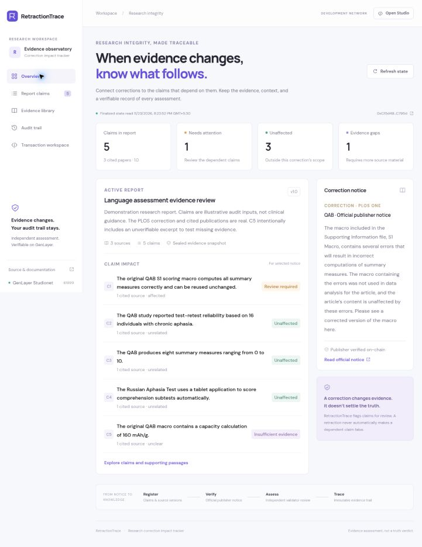

# RetractionTrace

**Research Correction Impact Tracker — built on GenLayer**

RetractionTrace maps official research corrections and retractions to the individual claims that cite a changed paper. A report's evidence is versioned and sealed; GenLayer validators independently verify publisher evidence and assess each dependency. The resulting audit trail distinguishes review flags from evidence that remains intact.

- **Live app:** https://retractiontrace.wirymink515.chatgpt.site
- **Contract:** [`0xCf5d49Ac30E8cc703683F38e0De0A50F492C795d`](https://explorer-studio.genlayer.com/address/0xCf5d49Ac30E8cc703683F38e0De0A50F492C795d)
- **Network:** GenLayer Studionet, chain ID **61999**
- **Open deployed contract in Studio:** https://studio.genlayer.com/contracts?import-contract=0xCf5d49Ac30E8cc703683F38e0De0A50F492C795d
- **Machine-readable live verification:** [public/verification.json](public/verification.json)
- **Submission text:** [docs/SUBMISSION.md](docs/SUBMISSION.md)



## The trust problem

A publisher can correct a paper while reports, grant reviews and DAO research retain claims based on the old evidence. A notice alone does not explain which dependent claims need review. RetractionTrace makes that relationship explicit and auditable. It does not decide whether a claim is ultimately true or false.

## Working MVP

A sample report contains **five claims, three cited papers, and a real PLOS ONE correction**. The correction identifies errors in a supporting scoring macro while explicitly stating that the macro was not used in the article's analysis. This is a useful test of claim-level reasoning: a macro-reuse claim needs review while claims about the published analysis can remain unaffected. An intentionally unverifiable passage exercises the missing-evidence path.

| Claim | Network-verified outcome | Why |
| --- | --- | --- |
| C1: reuse the original scoring macro unchanged | REVIEW_REQUIRED | Notice identifies macro errors |
| C2: study reliability sample of 16 participants | UNAFFECTED | Article's analysis explicitly unaffected |
| C3: eight summary measures on a 0–10 scale | UNAFFECTED | Claim concerns the described measures, not macro correctness |
| C4: automatic scoring in a different paper | UNAFFECTED | No dependency on the corrected paper |
| C5: an invented capacity-calculation excerpt | INSUFFICIENT_EVIDENCE | Input passage fails publisher verification |

C1 and C5 are deliberately questionable audit inputs, not endorsed findings. The report is illustrative, not clinical advice. PLOS publications and the correction are real. No outcome is hard-coded into the frontend: it reads finalized contract state.

## How the contract works

1. `register_report(report_id, report_json)` records immutable report/source content under the sender's ownership.
2. `link_claim_sources(report_id, links_json)` pins exact passage dependencies before evidence is sealed.
3. `submit_notice(report_id, notice_id, source_id, notice_doi, kind, exact_excerpt)` independently verifies official publisher JATS, own DOI, target-paper relationship, notice type and excerpt.
4. `assess_impact(report_id, notice_id)` fetches publisher sources, checks excerpt matches, and asks validators to independently interpret each claim's relationship to the notice.
5. `get_claim_status(report_id, claim_id)` returns conservative aggregate status and an append-only history across registered notices.

Additional getters: `list_reports()`, `get_report()`, `get_notice()`, `get_assessment()`.

The MVP supports **PLOS ONE publisher JATS** only, up to five claims and three papers per report. A DOI-derived fixed-host URL avoids arbitrary user-selected fetch destinations. Source version labels describe committed excerpts; unverified historical versions are not silently authenticated.

### Genuine consensus

`gl.vm.run_nondet_unsafe` executes a leader/validator protocol. Each validator independently fetches sources and reruns the semantic assessment, then compares claim relationships, independent remaining source IDs and exact cited passage IDs. It also checks proposed quotations against its own publisher results. A JSON-shape check alone cannot accept an assessment.

Statuses are derived deterministically from the verified relation and remaining support:

| Status | Meaning |
| --- | --- |
| UNAFFECTED | Changed passage is unrelated to the claim or the claim has no dependency on that paper |
| REVIEW_REQUIRED | Dependent evidence changed or was withdrawn; independent support was not established |
| SUPPORT_WEAKENED | Dependent evidence changed, but independently supporting cited evidence remains |
| INSUFFICIENT_EVIDENCE | Missing/unverifiable passages or ambiguity prevent a supported conclusion |

A retraction forces review of linked claims; it never proves them false. A later unrelated notice cannot erase an earlier review flag. Unassessed notices prevent an aggregate unaffected result.

## Use Studio's built-in account

No MetaMask or private-key import is required.

1. Open **Transaction workspace** and prepare one of the four write methods. Use a new report ID for your own report.
2. Review the exact arguments, then open the already deployed contract in GenLayer Studio.
3. Use Studio's built-in account, **Normal (Full Consensus)** mode and the matching method. Paste arguments into its fields and send.
4. Paste the transaction hash into RetractionTrace. Track pending → accepted → finalized; errors are shown separately.
5. Successful finality is followed by recipient/method/argument matching and a finalized-state postcondition check. Load your report by ID to explore it.

Studio isolates its account on its own origin; the signing handoff is explicit. The app never claims to have connected Studio's wallet as an injected provider, and never requests its private key. Only a report's owner can write its data. The app does not hold funds.

## Run locally

Requires Node.js 22+ and Python 3.12+.

```sh
npm ci
npm test
npm run build
npm run dev
```

The frontend's public network/address configuration is in `src/config.js`. No secret environment variables are needed for reading or the Studio signing workflow.

```sh
# Read-only: verify deployed source, finalized receipts, effects and evidence
npm run verify:live

# Read-only: validate the contract schema against live GenVM
node scripts/check-schema.mjs

# Optional: rebuild illustrative input snapshots from official publisher XML
python scripts/create-fixture.py
```

Do not redeploy to run tests. Deployment and live writes use Studio's built-in account. The tested source is pinned to the official documented Python runner; no floating `latest` dependency is deployed.

## Validation and evidence

- **32 automated tests passed:** 17 Python contract logic tests and 15 JavaScript lifecycle/input/effect-verification tests.
- **Live GenVM:** successful schema introspection and deployed-source equality.
- **Live network:** deployment, report registration, citation linkage, publisher notice verification and semantic assessment finalized with successful execution in NORMAL mode.
- **Negative network test:** an attempted second assessment finalized with an error, preserving the original immutable assessment. The frontend displayed failure.
- **Browser QA:** report reads, claim selection, search/status filters, evidence-match display, audit export, input preparation/copy, active transaction tracking, successful effect verification and failed execution display.
- **Evidence files:** [verified state](docs/verified-state.json), [verification manifest](public/verification.json), [screenshots](docs/screenshots/), [test report](docs/TESTING.md).

Python tests use an explicitly documented in-memory GenVM boundary double. They test actual contract logic but do not emulate real model reasoning or real consensus. The real correction flow was separately executed on the network. Independent-support and retraction scenarios are tested at the mocked boundary; no real retraction/independent replication transaction is claimed.

## Limitations and next steps

This is a functioning development-network MVP, not a production research-integrity service. Studionet can reset. Notices are manually registered, not continuously monitored. Author/contributor surname overlap is a conservative independence filter, not proof of dataset provenance. Models can make mistakes despite consensus. Only the supplied claim graph and excerpts are assessed, and the contract cannot parse a spreadsheet's formulas. Human review is still required.

Next: authenticated historical-version adapters, Crossref/Crossmark discovery, dataset provenance, reviewed resolution records, larger bounded report graphs and persistent-testnet deployment after compatibility/fee profiling.

## Source map

- `contracts/retractiontrace.py`: Intelligent Contract, input/evidence guards and consensus.
- `src/`: frontend, SDK reads, prepared inputs, transaction tracking and effect verification.
- `public/fixture.json`: reproducible illustrative inputs, not displayed outcome state.
- `public/verification.json`: verified network evidence and links.
- `tests/`: contract and frontend behavior tests.
- `scripts/`: read-only schema/live verification and fixture generation.
- `docs/`: architecture, demo, security boundaries, testing and Project Explorer submission.

See [architecture](docs/ARCHITECTURE.md) for the full trust model. MIT licensed. PLOS excerpts are attributed by DOI and covered by the publisher's open-access terms; code licensing does not override publication licensing.
